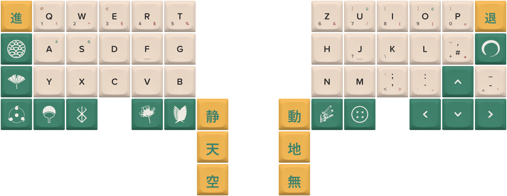
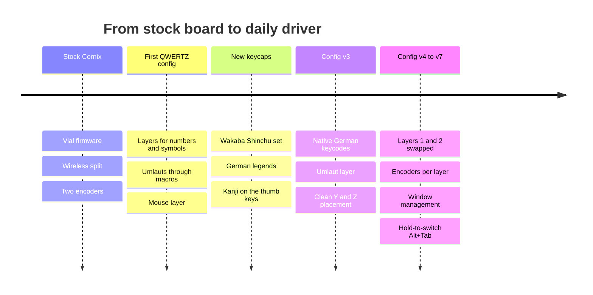

<div align="center">



# 若葉 · Cornix QWERTZ

**A wireless split keyboard, dressed in Japanese-inspired keycaps and tuned for German typing and a tiling window manager.**


-e8b04b?style=flat-square)


</div>

---

## The short version

I started with a stock **Cornix**, a compact, fully wireless split keyboard with two rotary encoders. Over several iterations I gave it a new face (the *Wakaba Shinchū* keycap set), taught it German (QWERTZ, umlauts, symbols) and finally turned both encoders into window-management tools for **komorebi**.

This repo is the whole journey: the keycap design, every config version I kept, and the reasoning behind each step.



---

## Chapter 1 · The stock Cornix

The Cornix is a **40 % left-right split** with **fully wireless** connectivity and ships with **Vial**, which means every key, layer and encoder can be remapped live from a GUI, with no compiling and no flashing a new firmware ([vendor's firmware notes](https://green-keys.info/en/firmware-v1-8-for-vial-version-of-cornix-lp-released/)).

That makes it a perfect playground:

| What | Why it matters |
| --- | --- |
| Split, wireless | Position each half freely, no cable between them |
| ~40 % key count | Everything beyond letters lives on layers |
| Two encoders (with push) | Four extra inputs per layer: turn left, turn right, press, per knob |
| Vial | Edit, export and version the keymap as a single `.vil` file |

---

## Chapter 2 · New keycaps: *Wakaba Shinchū*

*Wakaba* (若葉) is "young leaves", *shinchū* (新茶) is "new tea", and the colours say exactly that: **matcha green**, **warm cream** and **golden yellow**.

<p align="center">
  
</p>

- **Cream alphas** with German legends: shifted symbols in red, third-level characters (`@`, `€`, `ä`, `ö`, `ü`, `ß`, `{ [ ] }`) in green or brown, number row printed as the sub-legend.
- **Green icon keys** on modifiers and arrows: ornamental crest, fan, and a handful of pop-culture emblems.
- **Yellow kanji keys** on the thumb clusters and outer corners. They come in pairs:

| Key | Kanji | Meaning | Pair |
| --- | --- | --- | --- |
| Tab | 進 | advance | with 退 (Backspace), *retreat* |
| Left thumb | 静 | stillness | with 動 on the right, *motion* |
| Left thumb | 天 | heaven | with 地 on the right, *earth* |
| Left thumb | 空 | sky / void | with 無 on the right, *nothing* |

The set was designed as a dye-sublimated **DE layout** in a keycap configurator. The design file is included in [`keycaps/`](keycaps/cornix-de_79-wakaba-shinchu.json).

> Because the legends are German, the keyboard has to *behave* German. That is what the next chapter is about.

---

## Chapter 3 · Teaching it German

A physical QWERTZ legend only helps if the keycodes underneath match. The key ideas:

**1. Match the OS layout.**
The keymap sends standard keycodes that a *German* OS layout turns into the printed legends. The left `Y` key sends `KC_Z`, the right `Z` sends `KC_Y`, and so on.

**2. Put the third level on layers.**
All the characters printed in small type on the keycaps live on dedicated layers:

| Layer | Name | How to reach it | Contents |
| --- | --- | --- | --- |
| 0 | Base | always on | Letters, modifiers, arrows, space, enter |
| 1 | Function | hold `MO(1)` | F1 to F12, window-manager helpers |
| 2 | Numbers & symbols | hold `MO(2)` | `1`–`0`, `\`, `?`, `+`, `´`, `^`, `<`, Esc, Delete |
| 3 | Umlauts | tap `OSL(3)` | `ä` `ö` `ü` `ß` on `A` `O` `U` `S` |
| 4 | Mouse | hold `MO(4)` | Cursor keys as mouse, clicks, three acceleration steps |

**3. From macros to native keycodes.**
The first config relied on `AltGr`-based macros for the umlaut layer. From **v3** on, umlauts are native German-layout keycodes (`KC_QUOTE` → `ä`, `KC_SCOLON` → `ö`, `KC_LBRACKET` → `ü`, `KC_MINUS` → `ß`), which is simpler, faster and works in every app. The Y/Z placement was corrected at the same time.

**4. One-shot where it helps.**
Shift is a one-shot modifier (`OSM`), the umlaut layer is a one-shot layer (`OSL`), and `Caps Word` replaces Caps Lock: a capital letter or an umlaut without ever holding a key.

---

## Chapter 4 · Making the encoders earn their place

The base setup was simple: **left encoder = volume (press = mute)**, **right encoder = scroll**. Useful, but two knobs times seven layers is a lot of unused real estate.

### v4 · Swap layers 1 and 2
The two layers were exchanged, including their encoder maps, while the `MO(1)` / `MO(2)` keys stayed put. Same fingers, new content: the function layer now sits under the first thumb key, numbers and symbols under the second.

### v5 · Encoders per layer
| Layer | Left encoder | Right encoder |
| --- | --- | --- |
| 3 · Umlauts | Turn: select word left/right · **Press: copy** | Scroll |
| 1 · Function | Turn: volume · **Press: `Alt+M`** (minimize) | Turn: focus left/right · Press: fullscreen |
| 4 · Mouse | Turn: **switch tabs** · **Press: close tab** | Scroll · **Press: reopen closed tab** |

### v6 · Alt+Tab, but with a knob
A single `Alt+Tab` tap only jumps to the previous window, and holding it races through the list. Neither is useful for picking one window out of many, especially a **minimized** one (komorebi can minimize, but has no "unminimize" command).

The fix: the right encoder's push is a **layer-with-modifier key**, `LM(5, MOD_LALT)`. While held, `Alt` stays down and layer 5 turns the knob into `Tab` / `Shift+Tab`. Hold, turn to the window you want, release. Windows switches to it and komorebi re-tiles it.

### v7 · Focus *and* move with one knob
On the function layer the right encoder now does two jobs, depending on whether it is pressed:

| Gesture | Sends | komorebi action |
| --- | --- | --- |
| Turn | `Alt+H` / `Alt+L` | focus left / right |
| Hold + turn | `Alt+Shift+H` / `Alt+Shift+L` | move window left / right |
| Tap | `Alt+Shift+F` | fullscreen |

Technically this is a **tap dance** (`TD(0)`): *tap* sends fullscreen, *hold* activates layer 6 with `Shift` held (`LM(6, MOD_LSFT)`).

---

## The current layout (v7)

<details>
<summary><b>Layer 0 · Base</b></summary>

```
 Tab    Q  W  E  R  T                       Z  U  I  O  P   Bksp
 Caps*  A  S  D  F  G                       H  J  K  L  \   Alt
 Shift* Y  X  C  V  B   (mute)    (hold Alt+Tab) N  M  ,  .  ↑   /
 Ctrl   Win AltGr [L1] [L2] Space            Enter [L3] [L4] ←  ↓  →

 Left encoder   turn: volume down / up   · press: mute
 Right encoder  turn: scroll up / down   · hold + turn: Alt+Tab switcher
```
`*` = Caps Word / one-shot Shift. Legends follow the German keycaps.
</details>

<details>
<summary><b>Layers 1 to 4 · At a glance</b></summary>

| Layer | Keys | Left encoder | Right encoder |
| --- | --- | --- | --- |
| **1 · Function** | F1–F12 | volume · press `Alt+M` | focus · hold: move · tap: fullscreen |
| **2 · Numbers** | 0–9, `\` `?` `+` `´` `^` `<`, Esc, Del | volume · press mute | `Ctrl+Y` / `Ctrl+Z` · press `Ctrl+S` |
| **3 · Umlauts** | `ä` `ö` `ü` `ß` | word select · press copy | scroll · press middle click |
| **4 · Mouse** | ESDF-style mouse movement, clicks, accel | tabs · press close tab | scroll · press reopen tab |

</details>

---

## Repository layout

```
.
├── assets/
│   └── wakaba-shinchu-keycaps.png     # keycap render
├── keycaps/
│   └── cornix-de_79-wakaba-shinchu.json   # keycap design file
└── configs/
    ├── v1_initial_qwertz.vil          # first QWERTZ config (umlaut macros)
    ├── cornix_qwertz_DE_v3.vil        # native German keycodes
    ├── cornix_qwertz_DE_v4.vil        # layers 1 and 2 swapped
    ├── cornix_qwertz_DE_v5.vil        # per-layer encoders
    ├── cornix_qwertz_DE_v6.vil        # hold-to-switch Alt+Tab
    └── cornix_qwertz_DE_v7.vil        # focus + move + fullscreen  ← latest
```

Older versions are kept on purpose: each one is a working fallback.

## Using a config

1. Open **[Vial](https://get.vial.today/)** and connect the Cornix.
2. `File → Load saved layout…` and pick a `.vil` file from [`configs/`](configs/).
3. Check the encoder keys on layers 0 and 1: `LM(…)` and `TD(0)` should show as *layer + modifier* and *tap dance*. If a key looks empty, re-enter it via **Any**.

**Assumptions**
- The OS keyboard layout is **German (QWERTZ)**.
- The komorebi bindings below are in your `whkdrc`:

```
alt + h / l               : komorebic focus left / right
alt + shift + h / l       : komorebic move left / right
alt + shift + f           : (fullscreen)
alt + m                   : komorebic minimize
```

## Credits

- Keycap set *Cornix Wakaba Shinchū*, designed in a keycap configurator, dye-sublimated DE layout.
- [Vial](https://get.vial.today/) for making the keymap editable without a compiler.
- [komorebi](https://github.com/LGUG2Z/komorebi) for the tiling window manager this setup is built around.
